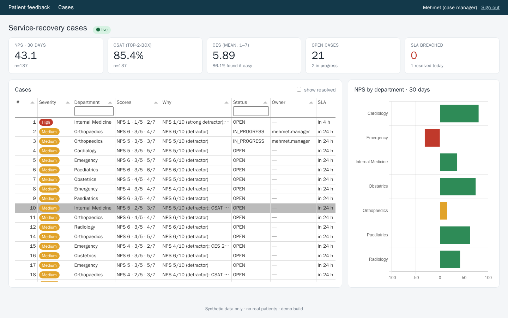
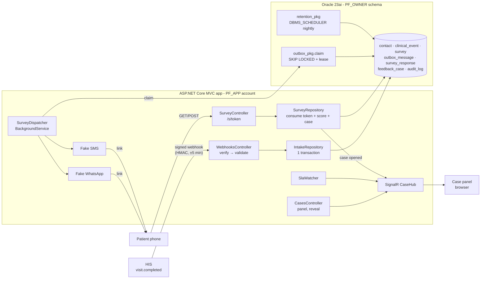
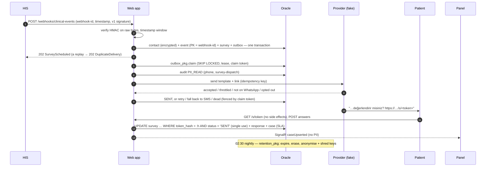
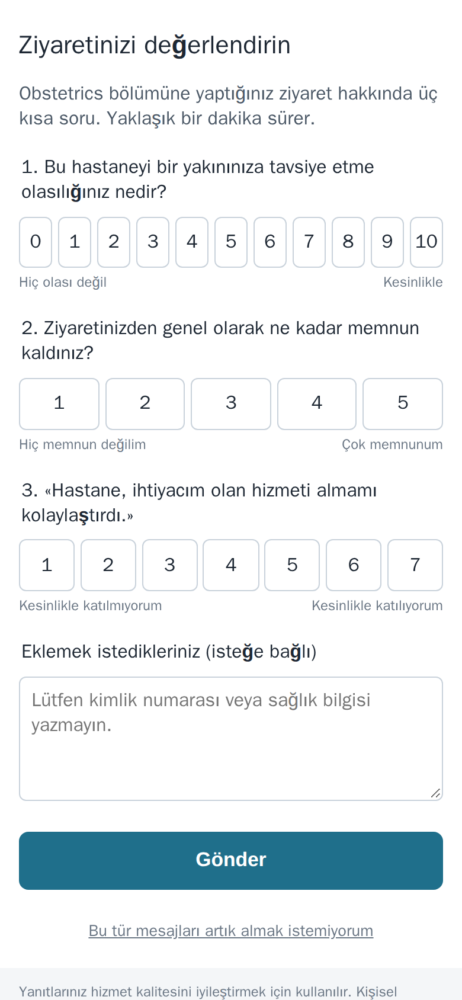
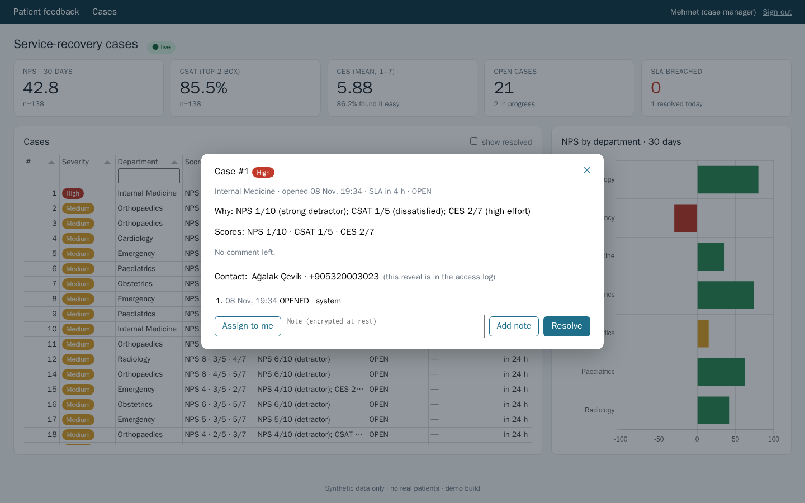

# patient-feedback-workflow

[](https://github.com/hekimcan206/patient-feedback-workflow/actions/workflows/ci.yml)
[](https://github.com/hekimcan206/patient-feedback-workflow/actions/workflows/codeql.yml)


[](LICENSE)

A **patient feedback and service-recovery module** for a hospital information system (HIS). It sends a survey
automatically after each visit and collects the answers on a one-time mobile link. It scores them as NPS, CSAT and
CES, opens a case with an SLA when the score is low, and puts that case on a live panel. The stack is ASP.NET Core
MVC, Dapper, Oracle PL/SQL and SignalR.

> **All data is synthetic; there is no real personal or health data in this repository.** Names come from Bogus (`tr`
> locale) and phone numbers from an unassigned block. The messaging providers are fakes with realistic failure
> modes. This is a from-scratch re-imagining of a module type used in hospital systems; no employer code, schema,
> screen or wording is used.



## Problem

Hospitals in Türkiye measure patient satisfaction, and the Ministry of Health's quality standards expect a feedback
loop. The hard part is not the questionnaire. It is everything around it:

- **The trigger must be trustworthy.** The HIS posts a "visit completed" event that carries a name and a phone
  number. A forged or replayed event makes the hospital message strangers, or the same patient over and over.
- **Delivery is messy.** WhatsApp throttles, some numbers are not on WhatsApp, SMS gateways return 503, and patients
  reply "IPTAL" (Turkish for "cancel"). A survey must be sent once: not zero times, not twice. It must not go out at
  23:00 or while the patient is still in the car park.
- **Links are bearer tokens.** Anyone holding the link can answer, and messaging apps prefetch links to build
  previews.
- **A low score is a complaint in progress.** Someone has to call the patient back within hours, and that needs the
  phone number. Who saw it, when, and why must be on record.
- **KVKK.** KVKK is Türkiye's personal data protection law (Law 6698). Health context attached to a phone number is
  special-category data. It must be encrypted, access-logged and destroyed on schedule: the regulation caps the
  periodic destruction interval at six months.

## Solution

| Concern | How | Where |
|---|---|---|
| Authentic events | Standard Webhooks HMAC-SHA256 over `id.timestamp.raw-body`, ±5 min window, **persisted** message-id de-duplication, constant-time compare, secret rotation | [ADR 0001](docs/adr/0001-hmac-signed-clinical-events.md) |
| Reliable dispatch | Transactional outbox in Oracle; PL/SQL claim with `FOR UPDATE SKIP LOCKED` + `LIMIT`, leases, fenced updates; retries with full-jitter back-off; WhatsApp → SMS fallback; opt-outs; quiet hours; provider idempotency keys | [ADR 0002](docs/adr/0002-oracle-outbox-with-skip-locked-leases.md) |
| One-time links | 256-bit tokens; only SHA-256 stored; consumed by a conditional `UPDATE`; GET never consumes; uniform 410; `no-referrer`, `no-store`, rate limit | `SurveyTokens`, `SurveyRepository` |
| Scoring | `NpsScoringService` (%9–10 − %0–6), `CsatScoringService` (top-2-box), `CesScoringService` (mean on 1–7 plus top-box share, each labelled). Counts are grouped in Oracle; the formulas live once, in tested C# | `src/PatientFeedback.Core/Scoring` |
| Service recovery | `CaseTriggerPolicy`: the worst answer sets the severity, and the severity sets the SLA (4 h / 24 h / 72 h). SLA watcher; assign, note and resolve actions | `Cases`, `CaseRepository` |
| Live panel | MVC actions change state, then SignalR pushes PII-free rows. Tabulator grid + Chart.js (MIT), no DevExtreme licence | [ADR 0005](docs/adr/0005-mvc-signalr-and-free-ui-stack.md) |
| PII at rest | AES-256-GCM envelope encryption per contact; KEK outside the DB; associated data binds each ciphertext to its row and field; blind indexes for lookups; audited reveal with a stated purpose | [ADR 0003](docs/adr/0003-application-level-envelope-encryption.md) |
| Audit | Every PII read, write, reveal, opt-out and anonymisation is logged with actor, fields, purpose, trace id and DB user. The app account can only INSERT and SELECT | `audit_log`, `/audit` |
| Retention | `retention_pkg` (PL/SQL) run nightly by `DBMS_SCHEDULER`: links expire, free text is erased at 180 days, contacts are anonymised at 365 days after last activity with **crypto-shredding**, and an open case holds the contact | [ADR 0004](docs/adr/0004-retention-in-plsql-with-dbms-scheduler.md), [policy](docs/kvkk-retention-policy.md) |

## Architecture





## Why this design

- **Signature checks on raw bytes, de-duplication in the database.** A valid signature does not stop a replay inside
  the window. An in-memory "seen ids" cache forgets on restart and is not shared across instances. The webhook id is
  the primary key of `clinical_event`, and the visit id is unique on `survey`. Eight concurrent deliveries of one
  message produce exactly one survey (tested).
- **Outbox in the same database, not a broker.** The survey and its message commit together. Oracle `SKIP LOCKED`
  with leases gives competing consumers and crash recovery without new infrastructure. The fenced updates mean a
  worker whose lease expired cannot overwrite a newer result. The first load test found the real bottleneck, a
  per-row audit insert, and fixing it took dispatch from 77 to 180 messages/s ([benchmarks](docs/benchmarks.md)).
- **Encryption in the application, not TDE.** TDE stops a stolen disk but not `SELECT`. With envelope encryption a
  DBA, a report or a dump sees ciphertext. Destroying one 48-byte wrapped key makes a contact unreadable everywhere,
  including in backups the retention job cannot touch.
- **Retention in PL/SQL with DBMS_SCHEDULER.** It runs where the data lives, whether or not a web instance is up,
  with definer rights the web account does not have. A compromised web tier cannot trigger mass anonymisation or
  delete audit rows.
- **SignalR for broadcast only.** All changes go through MVC actions that authorise, validate, audit and then push.
  The hub never accepts commands, so there is one security path.

## Quick start

```bash
docker compose up --build
```

Then open **http://localhost:18440**, choose a demo role and watch the panel fill. The simulator posts a signed visit
every 2 seconds and answers about 70% of the surveys. Roles:

- **Mehmet (case manager)** can reveal contact details (audited).
- **Ayşe (agent)** sees masked contacts only.
- **Selin (DPO)** sees the access log and the retention runs.

| Service | What it does |
|---|---|
| `oracle` | Oracle Database 23ai Free; `deploy/oracle/init` creates `PF_OWNER` (DDL + CREATE JOB) and `PF_APP` (no objects) |
| `installer` | same image, `--init-oracle`: schema, packages, grants, DBMS_SCHEDULER job; exits |
| `web` | the MVC app as `PF_APP` (port 18440) |
| `simulator` | synthetic HIS + patients |

Local development without containers for the app: `docker compose up oracle installer`, then
`ConnectionStrings__OracleApp="Data Source=localhost:15240/FREEPDB1;User Id=pf_app;Password=AppDev1" dotnet run --project src/PatientFeedback.Web`
(Development settings supply dev-only keys, immediate dispatch and the simulation endpoints).

```bash
dotnet test        # 145 tests: 119 unit/property/HTTP + 26 Oracle Testcontainers incl. end-to-end
```

<details>
<summary>Mobile survey page and case detail</summary>

| Patient's phone (Turkish UI, works without JavaScript) | Case detail: comment, timeline, audited reveal |
|---|---|
|  |  |

</details>

## Results

Measured on a laptop (i7-13620H, Docker Desktop on Windows 11; app and Oracle in containers). Method, environment and
raw output are in [docs/benchmarks.md](docs/benchmarks.md).

| Measurement | Result |
|---|---|
| Webhook → provider accepted, steady trickle (median of 3 runs) | **p50 103 ms**, p95 218 ms, p99 1.56 s (p99 = the 1 s Retry-After on throttled WhatsApp sends) |
| Webhook intake, burst of 2,000 at concurrency 16 | 256 webhooks/s, p50 35.7 ms, p95 125.3 ms |
| End-to-end dispatch under the same burst | **180 messages/s** (77 before the array-bound audit and concurrency fix); webhook → accepted p50 1.13 s (10.1 s before) |
| Survey completion (GET + POST, one connection per patient) | **225 completed surveys/s**, p50 61.9 ms, p95 120.7 ms |
| Tests | **145 passing**: 119 unit / FsCheck property / HTTP surface, 26 Testcontainers Oracle tests incl. PL/SQL retention, the DBMS_SCHEDULER job and the end-to-end flow |

What the tests prove (selection):

- **HMAC:** ±300 s accepted and ±301 s rejected; a capture replayed an hour later is rejected; one changed body byte
  fails; both rotation directions work; rejection time is the same whether the first or the last byte is wrong.
- **Exactly once:** 8 concurrent deliveries of one webhook → 1 survey; 6 concurrent submits of one link → 1
  response; 4 competing dispatchers → disjoint claims; a stale worker whose lease expired cannot overwrite the new
  owner's result.
- **Scoring properties:** NPS always in [−100, 100], independent of response order, never lowered by an added
  promoter; it matches the count formula. A lower NPS never yields a lower case severity, and a case opens exactly
  when some answer crosses a threshold.
- **Privacy:** no plaintext name or phone in stored bytes; a ciphertext moved to another field fails; KEK rotation
  re-wraps without touching fields; the app account cannot DELETE, UPDATE the audit log or run retention (ORA-41900 /
  ORA-01031).
- **Retention:** day 364 keeps and day 366 anonymises and shreds; an open case holds the contact; link expiry;
  180-day free-text erasure; idempotent re-runs; batch boundaries; `DBMS_SCHEDULER.RUN_JOB` produces a `SCHEDULER`
  run.
- **End to end:** signed event → WhatsApp delivery → link opened twice → low score → case with a 4 h SLA pushed
  over SignalR → link single-use → comment readable by the case manager, with audit rows. Also: a number that is not
  on WhatsApp falls back to SMS, and an agent's reveal attempt gets 403.

## Mirrors a .NET 8 production stack

The CV module this re-imagines ran on **.NET 8 / ASP.NET Core MVC, Dapper and Oracle**. This repository targets
**.NET 10** to match the rest of the portfolio. Nothing depends on .NET 10 except `Base64Url` (since .NET 9) and
minor C# conveniences. The UI uses free MIT libraries (Tabulator, Chart.js, the SignalR JS client) in place of a
commercial DevExtreme licence ([ADR 0005](docs/adr/0005-mvc-signalr-and-free-ui-stack.md)).

## Repository layout

```
src/PatientFeedback.Core        scoring, case policy, webhook verifier, tokens, envelope encryption, dispatch planner (no I/O)
src/PatientFeedback.Oracle      Dapper repositories, schema installer, embedded SQL
src/PatientFeedback.Web         MVC controllers + Razor views, SignalR hub, dispatcher & SLA watcher, fake providers
src/PatientFeedback.Synthetic   Bogus (tr) visit/answer generator, simulated HIS and patients
src/PatientFeedback.Simulator   compose demo driver
db/oracle/schema                tables, outbox_pkg, retention_pkg, grants
tests/                          UnitTests (xunit v3, FsCheck, WebApplicationFactory), OracleTests (Testcontainers)
benchmarks/                     load test (intake, dispatch latency via Oracle PERCENTILE_CONT, survey throughput)
tools/screenshots               Playwright capture script for the README images
```

## Limitations and next steps

- **Fake providers.** Real adapters (WhatsApp Business Cloud API templates, an SMS gateway) need HTTP clients with
  resilience policies, delivery-receipt webhooks and the provider's own callback signature scheme. The adapter
  interface and the failure classification are in place.
- **Identity:** demo sign-in stands in for the hospital's OIDC provider.
- **Keys:** KEKs come from configuration. Production needs KMS/HSM custody and a scheduled rewrap after rotation.
  ASP.NET Data Protection keys are per container, so scale-out needs a shared key ring and a SignalR backplane.
- **Schema migrations:** the installer creates tables on an empty schema and re-applies packages and grants on every
  start. Altering existing tables would need versioned migrations.
- **Reporting:** the panel shows 30-day aggregates. Trend reports, per-physician breakdowns (with k-anonymity
  thresholds) and text analytics on comments are not built.
- **Delivery receipts / read status** are not modelled; "sent" means "provider accepted".

## Privacy note (KVKK)

All data here is synthetic. The design follows KVKK principles:

- **Data minimisation:** no diagnosis and no TCKN (national ID number) are accepted.
- **Consent gate:** without consent nothing personal is stored.
- **Encryption at rest** and **purpose-bound, audited access**.
- **Periodic destruction:** nightly, far inside the six-month ceiling, with crypto-shredding.

See [docs/kvkk-retention-policy.md](docs/kvkk-retention-policy.md) and [docs/threat-model.md](docs/threat-model.md).

## License

[MIT](LICENSE)
